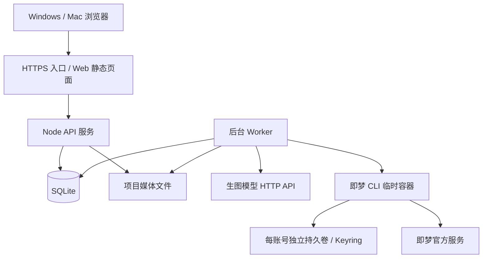

# LumenX 漫剧工作台 B/S 改造方案

日期：2026-10-19。状态：开发设计，尚未实施。范围：当前 `prototypes/storydock` Electron 漫剧工作台，不包含仓库内其他 Studio / Atelier 产品的重构。

## 1. 推荐决策

第一版定位为个人或小团队共用的单工作区 Web 应用。保留白色、精简的项目 / 资产 / 分镜 / 队列界面。所有业务数据、媒体、模型密钥、即梦授权凭据和任务运行放在一台 Linux x64 服务器。用户电脑只需要浏览器，不安装 Electron、Docker、WSL 或 CLI。

技术组合：现有 HTML/CSS/JS 页面 + Fastify HTTP API + Node.js 后台 Worker + SQLite WAL + 服务器文件系统 + Docker Engine 中的官方 Dreamina CLI。

选 Node.js 是为了继续使用现有 `.cjs` 生图、CLI、媒体和项目包模块，减少重写。第一版不引入 Redis、多机调度或完整用户管理。数据库是权威状态源；浏览器只保存筛选、布局等临时状态，不再保存整个 workspace。

默认通过局域网或 VPN 访问，保留用户此前“不需要账号登录”的使用方式。若部署到公网，入口增加访问密码或现有身份网关；该访问控制和即梦账号池相互独立。接口、媒体、事件流和下载必须经过同一访问控制。

## 2. 架构与部署边界



API 与 Worker 作为两个 systemd 服务运行在同一宿主机，方便共用本地 SQLite 和绝对媒体路径。Docker 仅运行 CLI 沙箱。API 无 Docker socket 权限；Worker 使用专用执行用户控制 Docker。Docker 控制权限相当于高权限，不向浏览器开放 Docker 命令、镜像名、挂载路径或任意 shell 参数。

CLI 镜像由部署脚本提前构建并固定 digest，运行时不自动下载最新版。沿用每次命令启动临时容器、挂载指定账号卷、命令完成销毁容器的方式。Keyring 凭据保留在卷内。

不采用 API 容器内再执行 Docker 的部署方式，避免宿主机与 API 容器的路径不一致导致参考图挂载失败。未来容器化 API 时必须单独设计 hostPath 映射，不能原样复用当前 `--mount source=...`。

服务器起步资源建议：4 vCPU、8 GB 内存、100 GB SSD；这是容量估计，不是实测吞吐承诺。生成计算在供应商运行，服务器承担上传、CLI、轮询、下载与存储。实际并发由账号额度、平台限制、内存和带宽验收后配置。磁盘按每天生成视频总大小规划。

## 3. 产品界面

| 页面 | 用户操作 | 改造结果 |
|---|---|---|
| 我的项目 | 创建、编辑、删除、恢复、备份 | 多浏览器读取同一服务器项目 |
| 资产库 | 导入清单、改提示词、上传参考图、生成、选版本、固定 | 文件上传到服务器，版本以媒体 ID 保存 |
| 分镜脚本 | 导入整部剧、编辑、绑定资产、批量生成 | 提交前显示本次携带的图片和顺序 |
| 生成队列 | 查看状态、错误、视频、下载、重试 | 关浏览器后服务器继续执行 |
| 模型与账号 | 配置生图 API、添加即梦账号、授权、暂停 | 显示服务器环境状态，无客户端安装按钮 |

第一版沿用现有提示词导入格式，Codex 仍作为外部创作工具。项目中增加原始剧本文本/文件保存位置即可；自动分析剧本不是本次迁移的前置依赖。

页面不显示伪造进度百分比。状态文案为：待分配、准备参考图、提交中、提交待确认、即梦排队/生成中、下载中、已完成、失败、授权失效。只有官方返回的数据才显示队列位置和预计时间。

删除项目采用软删除；有运行任务时显示影响，停止后续新提交，已接受的远端任务继续查询归档。媒体清理为独立保留策略，不因删除按钮立即物理清除。可以删除最后一个项目，显示“创建项目”空状态。

## 4. 服务端即梦授权与账号池

### 4.1 授权流程

1. 浏览器新增账号别名，API 创建账号 UUID。
2. 点击“授权”，API 创建授权会话并返回 `authSessionId`，Worker 在该账号独立卷执行 `dreamina login --headless`。
3. Worker 解析官方授权地址、设备码与有效期。设备码加密写入服务端 `auth_sessions`，不再保存在内存 Map。若 CLI 不提供有效期，使用保守本地有效期并处理官方到期错误。
4. 浏览器轮询会话状态，获得 `authorizationUrl` 后展示“打开即梦授权页”链接。由用户点击链接打开新标签页，避免异步请求结束后 `window.open` 被拦截。
5. 用户在即梦官方页面登录并授权。此网页登录态在用户自己的浏览器；服务器只持有官方 CLI 授权状态，不复制浏览器 Cookie。
6. Worker 执行 `dreamina login checklogin --device_code=... --poll=20`，完成后执行 `user_credit`。授权、权限、额度分别持久化。
7. 前端显示账号名、检查时间、额度、授权状态和 CLI 生成权限。标识能解析时用稳定哈希识别重复账号；不能可靠识别时标为“身份待确认”，不能假装已经去重。

B/S 浏览器无法复用 Electron 的每账号独立浏览器 session。用户授权第二个即梦账号时，需要在官方页切换账号，或使用另一个浏览器配置文件。页面明确提示本次应授权哪个别名，完成后检查身份，防止多个别名实际授权同一账号。首版不做远程浏览器、iframe 内嵌登录或 Cookie 采集。

### 4.2 凭据与账号并发

- 将 `safeStorage` 替换为服务端 `SecretStore`，提供 `encrypt/decrypt`。AES-256-GCM，随机 nonce，账号 ID 和用途作为 AAD；主密钥通过服务器独立密钥文件提供，不写入 Git、SQLite 或项目导出。
- 每个账号沿用独立 Docker volume、独立 Keyring 解锁密码；临时密码文件存于 Worker 私有运行目录，权限 0600，调用完成清除。
- 同一账号的 CLI 操作以持久租约串行，避免授权、提交、查询同时修改同一 Keyring 或 CLI 本地文件；不同账号可并行。
- “正在运行 CLI 的数量”和“已提交远端任务数量”分别计数。远端任务等待期间释放容器及 CLI 操作锁，但保留账号任务容量占用。
- 账号选择默认轮询，支持空闲优先；仅选择启用、授权有效、权限允许、未冷却、有剩余容量的账号。
- 首次先以每账号一个远端任务的保守上限验收，再按平台实际限制配置，不以多账号绕过额度或平台限制。
- 授权过期则停止该账号的新提交。已提交任务始终使用原账号查询，不迁移到另一个账号。

## 5. 资产与参考图绑定

编辑器继续允许输入 `@资产名`，导入后解析为 `assetId`。同名歧义要求确认；新任务不再仅依赖字符串查找。

创建任务时，API 在同一事务内冻结：原提示词、提交提示词、引用资产 ID、版本 ID、媒体 ID、图片顺序、名称快照、模型配置版本、画幅和时长。后续重命名/换图不改变已有任务。

示例：

```json
{
  "shotId": "shot-uuid",
  "promptOriginal": "@宫廷 中，@少年 转身。",
  "references": [
    {"assetId":"scene-uuid","versionId":"v1","mediaId":"media-a","index":1},
    {"assetId":"character-uuid","versionId":"v3","mediaId":"media-b","index":2}
  ],
  "promptSubmitted": "参考图1对应资产‘宫廷’；参考图2对应资产‘少年’。参考图1中，参考图2转身。"
}
```

Worker 根据媒体 ID 查服务器路径，按顺序复制到任务 input 目录，执行已存在的重复 `--image /work/input/01.png` 参数。浏览器不能提交本机绝对路径或容器挂载参数。

现有数字参考图说明 + 实际图片参数的传输机制可以复用，但这不是即梦网页蓝色 @ 标签的内部结构。参数顺序测试只能证明图片随请求传输，不能证明模型语义理解完全正确。正式验收用两张差异明显的参考图，检查远端记录与输出；资产名前缀重叠时采用结构化 token/最长匹配，防止 `@少年` 错误替换 `@少年·外勤装`。

## 6. 持久队列与故障恢复

所有生图、视频、下载、导出均先写数据库，再由 Worker 执行。HTTP 提交接口快速返回 202 和 job ID；不让浏览器请求等待生成完成。

```text
queued → preparing → submitting → remote_running → downloading → succeeded
                         ↓               ↓               ↓
                  submit_unknown        failed       download_failed
```

任务字段至少包含：`id/project_id/source_id/kind/status/account_id/provider/model/config_snapshot/input_snapshot/remote_task_id/attempt/next_run_at/lease_owner/lease_until/version/error_code/error_message/created_at/updated_at`。

领取任务使用 SQLite 短事务：选取到期、未持有有效租约的记录，条件更新租约并递增版本；领取后提交事务，再执行网络/CLI 操作。耗时操作不持有数据库事务。更新结果必须检查租约所有者与版本，防止过期 Worker 覆盖新结果。每账号操作租约同样持久化。

创建任务要求 `Idempotency-Key`，对工作区、接口、键和请求体哈希建立唯一约束；重复点击返回已有任务，键复用但请求体不同返回冲突。

数据库幂等无法保证外部生成“严格恰好一次”：如果供应商已接收但本机未保存 ID 就崩溃，不能直接重试。进入 `submit_unknown`，显示“提交待确认”，尝试按官方 CLI 能力核对记录；无法唯一对应则由用户检查后明确重新提交。

按状态恢复：

| 中断位置 | 恢复策略 |
|---|---|
| 排队/准备图片 | 租约到期后重新准备 |
| 提交中，无远端 ID | 标记提交待确认，禁止自动重发 |
| 已有远端 ID | 原账号继续查询 |
| 下载中 | 原任务重新下载，不重新生成 |
| 下载成功，数据库未更新 | 检查文件、校验摘要，补完成事务 |
| 授权中 | 读取加密授权会话继续检查；过期则重新授权 |

CLI 子进程超时要终止对应命名容器并确认退出，再释放操作锁；现有仅等待 `execFile` 超时的方式不足。查询失败采用有上限的退避与抖动；低额度/权限/内容错误不无限重试。API 断开、浏览器刷新或关闭均不影响 Worker。

视频“暂停”只暂停尚未提交的本地任务。现有适配器尚未验证官方远端取消命令，因此不提供“远端取消成功”的承诺。生成已被接受后，仍可能消耗额度。

APIMart 生图同样拆成 submit / query / download，把图片供应商 task ID 在取得后立即落库；现有 `generateImage()` 把提交、轮询和下载包在一次调用里，不能原样作为可恢复队列。OpenAI 同步接口若请求结果不明，也进入待确认状态。

## 7. 数据库与媒体

首版 SQLite WAL 支持一个 API 服务与一个 Worker，在同一主机本地磁盘访问；不放到 NFS，不跨机器共享 SQLite。事务短小，设置 busy_timeout。未来增加多机 Worker 再迁 PostgreSQL。

表结构按业务拆分：

| 表 | 核心用途 |
|---|---|
| projects | 名称、简介、画幅、风格、revision、deleted_at |
| assets / asset_versions | 资产元信息、提示词、固定版本、版本媒体 |
| asset_references | 生图参考媒体及顺序 |
| shots / shot_references | 集数、镜头排序、提示词、资产绑定 |
| media | 相对存储键、类型、字节数、SHA-256、来源 |
| model_connections / secrets | 模型配置及加密密钥引用 |
| jimeng_accounts / auth_sessions | 账号池、权限、授权会话 |
| jobs / job_attempts / job_events | 队列、调用尝试、事件与恢复证据 |
| account_leases / idempotency_keys | 操作串行与请求去重 |

不继续用 `saveWorkspace()` 覆盖整库。编辑使用 revision 条件更新；两个浏览器编辑冲突返回 409，提示重新加载，避免最后保存覆盖别人生成的结果。

存储建议：

```text
/srv/storydock/
  data/storydock.sqlite
  media/<project-id>/assets/<asset-id>/<sha256>.png
  media/<project-id>/videos/<job-id>/output.mp4
  runs/<job-id>/input/
  backups/
/etc/storydock/master-key                 # 独立备份、严格权限
/run/storydock/                           # 临时解锁文件
Docker volumes: storydock-dreamina-<account-uuid>
```

浏览器使用 `/api/v1/media/<mediaId>`，不暴露宿主机路径。视频提供 HTTP Range、Content-Type、Content-Length 以支持预览拖动。下载写临时文件，校验类型/大小/摘要后原子重命名。页面只引用已登记的媒体。

导出视频按 `集数 → 镜头序号 → 稳定排序键` 排序，文件名例如 `E001_S0001_镜头名.mp4`，同名追加短 ID，附 manifest。缺失/失败分镜在下载前列出，不静默跳过。ZIP 流式生成或后台归档，避免整个项目读入内存。浏览器下载到用户选择的默认下载目录，无法直接写任意本机路径或操作本机剪映。

## 8. HTTP 接口契约

统一前缀 `/api/v1`；错误结构 `{error:{code,message,requestId}}`，不向页面返回设备码、token、API key 或未脱敏 CLI 输出。

| 方法与路径 | 行为 |
|---|---|
| GET/POST `/projects` | 项目列表/创建 |
| GET/PATCH/DELETE `/projects/:id` | 详情/条件编辑/软删除 |
| POST `/projects/:id/assets/import` | 清单校验、预览、确认写入 |
| PATCH `/assets/:id` | 修改名称、描述、提示词 |
| POST `/assets/:id/references` | multipart 上传参考图 |
| POST `/assets/:id/versions` | 上传成品版本 |
| PUT `/assets/:id/locked-version` | 固定/解锁指定版本 |
| POST `/projects/:id/shots/import` | 结构化导入分镜与资产引用 |
| PATCH `/shots/:id` | 修改分镜，校验 revision |
| POST `/projects/:id/jobs/batch` | 创建图片/视频任务，返回 batchId 和 jobIds |
| GET `/projects/:id/jobs` | 筛选/分页读取服务端状态 |
| POST `/jobs/:id/retry` | 按失败阶段重试；待确认提交需显式确认 |
| POST `/batches/:id/pause` | 暂停尚未提交任务 |
| GET `/events?after=:seq` | SSE 更新；持久 seq，断线后可补读 |
| GET/PUT `/connections/image` | 读取配置/更新配置及密钥，返回时掩码 |
| GET/POST `/jimeng/accounts` | 账号列表/新增别名 |
| PATCH/DELETE `/jimeng/accounts/:id` | 暂停、编辑、移除；运行任务期间禁止物理销毁卷 |
| POST `/jimeng/accounts/:id/auth-sessions` | 创建异步授权会话 |
| GET `/jimeng/auth-sessions/:id` | 状态、官方授权 URL、有效期 |
| POST `/jimeng/accounts/:id/check` | 后台检查权限/额度 |
| GET `/system/runtime` | CLI 版本、可用性、磁盘状态 |
| GET `/media/:id` | 受控图片/视频服务 |
| POST `/projects/:id/exports` | 创建项目备份或排序视频包任务 |
| GET `/exports/:id/download` | 下载已完成归档 |
| POST `/imports` | 上传并验证旧项目包 |

SSE 只负责通知，断线后可回退 GET 查询；不能作为任务数据库。文件上传验证字节内容、扩展名、大小和项目归属；项目包解压防目录穿越、符号链接和解压体积超限。模型 Base URL 仅管理员配置；服务端下载 URL 限制协议、重定向、内网地址与字节数，避免服务器被当成任意网络代理。

## 9. 代码迁移清单

```text
prototypes/storydock/
  web/                    # 保留现有页面视觉和业务编辑器
    api.js                # 替代 window.desktop，所有业务走 HTTP
  server/
    api.cjs
    routes/
    repositories/
    migrations/
    secret-store.cjs
    media-service.cjs
  worker/
    main.cjs
    scheduler.cjs
    account-leases.cjs
    providers/image.cjs
    providers/jimeng.cjs
  deploy/
    systemd/
    reverse-proxy.conf
    cli/Dockerfile
    cli/entrypoint.sh
    install.sh
    backup.sh
```

| 当前文件 | 处理 |
|---|---|
| `app.js`, `style.css` | 保留界面；移除演示分支、页面任务执行和全量保存；加 HTTP 操作与 loading/error |
| `preload.cjs`, `electron.cjs` | HTTP routes 接管 IPC；Electron 不再是运行依赖 |
| `jimeng-cli.cjs` | 保留命令与解析；注入 SecretStore、持久授权会话、账号锁、容器清理 |
| `image-provider.cjs` | 复用协议处理；拆提交/查询/下载，持久化远端 task ID |
| `database.cjs` | JSON blob 改结构化表、迁移脚本、条件更新和队列租约 |
| `media-store.cjs` | URL 改媒体 ID；复用内容哈希和原子落盘 |
| `project-package.cjs` | 打包服务器媒体，修复跨账号输出目录归档，增加安全导入 |
| `account-sessions.cjs` | Electron Cookie session 不迁入 Web；改用官方 CLI 授权 |

## 10. 旧数据迁移

先完整备份桌面 SQLite、项目媒体目录、CLI 输出目录和账号卷。旧程序保持可回退。

项目数据迁移为结构化记录；保留资产外部 key、集数/镜头编号、版本和引用关系。所有 `file://` 路径必须解析复制到服务器并替换为媒体 ID，缺失文件出报告。

现有视频通常在 `storydock-jimeng-cli/<account-id>/outputs/<submit-id>`，不在 `projects/<project-id>` 内；现有项目导出器只复制项目媒体目录，可能遗漏视频。必须补一个显式迁移导出工具，将 job.video、历史版本、生图参考图、视频结果统一收集；不可只依赖当前“导出项目包”按钮。

API key 和 Keyring 解锁密码受 Electron 系统加密保护，不能直接把 `.enc` 文件拷到 Linux 解密。默认在服务端重新填写模型密钥、重新逐账号 OAuth 授权。若迁移未完成远端任务，保存远端 ID 和原账号身份，重新授权同一账号后再查询，不能自动重发。

旧 localStorage 只作辅助恢复源；与 SQLite 不一致时先预览、由用户选择，不能静默覆盖。迁移报告包含项目数、资产数、分镜数、图片数、视频数、丢失文件和待重新授权账号。

## 11. 开发阶段与验收

| 阶段 | 交付 | 必须通过的验收 |
|---|---|---|
| 1. 服务端基础 | HTTP、SQLite schema、SecretStore、媒体读写、项目 CRUD | 两个浏览器同步读写；冲突返回409；视频Range预览；无 Electron 依赖 |
| 2. 生图闭环 | 模型配置、参考图上传、持久队列、版本固定 | 标准 OpenAI/APIMart 桩测试；目标服务器实际生图；关闭页面继续执行 |
| 3. 官方 CLI 账号池 | Linux 镜像、OAuth、权限检查、账号锁 | 真实两个账号授权；重启后登录态保留；错误账号不能查询别人任务 |
| 4. 分镜闭环 | 资产快照、图片上传、视频提交/查询/下载、SSE | 实际带两张参考图生成；对照绑定；按集数镜头下载；重启恢复 |
| 5. 数据迁移和部署 | 老项目导入、备份、systemd、入口访问配置 | 图片/视频/引用数量核对；从备份恢复；浏览器无需 Docker |

重启与异常测试覆盖：提交前崩溃、提交后未保存ID、远端ID已保存、下载中断、租约过期、重复提交、CLI超时遗留容器、授权过期、服务器磁盘不足。需要真实生成的验收用最小任务，记录对应版本、账号、远端ID和媒体摘要；测试账单按供应商实际计费。

## 12. 已验证和待验证的边界

2026-10-19 本轮重新验证：现有 56 项自动测试通过；本机已有镜像 `lumenx-dreamina-eval:1.4.20-amd64-verify` 被 Docker 识别为 `linux/amd64`；实际执行官方二进制 `version` 返回 1.4.21（镜像测试标签与二进制版本不同，不能按标签推断版本），并提示测试镜像缺少本地版本文件。

本会话此前执行过 Linux AMD64 容器内 `login --headless`，返回官方授权 URL 和设备码；此前真实执行证据不代表新服务器已经完成 OAuth 或视频端到端验收。

现有自动测试证明 CLI 参数构建、输出解析和隔离路径等行为，其中大部分供应商交互使用桩。当前 B/S API、持久调度、多浏览器一致性、目标服务器网络、多账号重启恢复、带参考图真实生成和服务端备份恢复尚未实现或尚未在目标环境验收。必须按第11节逐项通过才可宣称完成 B/S 迁移。

上线前需在目标 Linux 服务器验证到即梦授权/生成/媒体域名、生图中转域名和镜像依赖源的网络连通；服务器能运行 Linux 容器不能替代这项验证。

## 13. 运维与回退

健康检查区分 API 存活、Worker 心跳、SQLite 可写、CLI 可执行和磁盘可用。日志以 requestId/jobId/accountId 关联并脱敏，不记录 token、设备码、API key 或完整敏感 CLI 输出。

数据库通过 SQLite 在线备份接口形成一致性副本，媒体按引用清单备份；账号卷与解锁密码密文一并备份，主密钥单独保存并演练恢复。升级前备份，数据库迁移使用版本号；发生不可兼容 schema 变更时从备份恢复，不让旧程序写新库。

浏览器文件下载到本机由浏览器控制。服务端无法自动把视频写入用户指定本机文件夹或操控剪映；首版提供按分镜排序的视频ZIP和清单，后续若要一键导入剪映，再增加经过独立验证的草稿导出能力或可选桌面助手。

参考：
- 即梦官方 CLI 安装入口：https://jimeng.jianying.com/ai-tool/install
- 官方安装脚本：https://jimeng.jianying.com/cli
- Docker daemon 权限边界：https://docs.docker.com/engine/security/protect-access/
